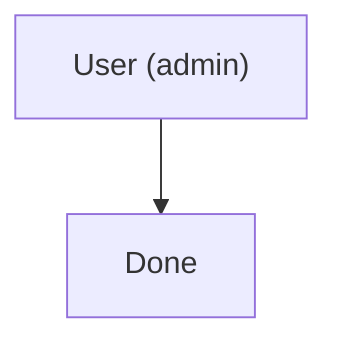
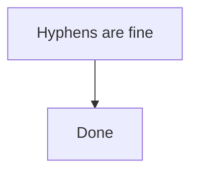
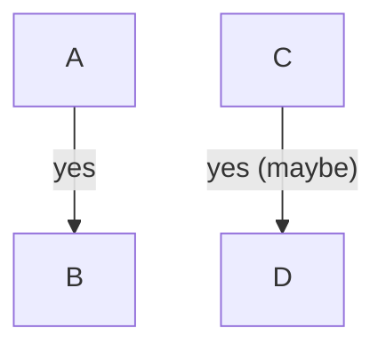

# Escaping, Labels, and Node IDs

Most "my diagram won't render" bugs are label-quoting bugs, and most escaping
advice found in the wild is wrong in ways that silently corrupt text. The rules
below were verified by rendering each case through `@mermaid-js/mermaid-cli` v11
at default config — the same rendering path GitHub, mermaid.live, and the CLI
use for flowcharts (HTML labels).

## The one rule that matters: quote every label



Unquoted, this is a hard parse error:

```
flowchart TD
    A[User (admin)] --> B[Done]     %% Parse error on line 2
```

Quoting is what makes parentheses, braces, semicolons, pipes, and even unbalanced
brackets safe. `A["arr[0"]` renders fine; `A[arr[0]` is a parse error. Rather
than memorizing which punctuation is dangerous, **quote unconditionally** and the
question mostly disappears.

## What you must still escape inside quotes

| Character | Write | Why |
|---|---|---|
| `"` | `&quot;` | A raw inner `"` is **silently dropped** — `"He said "hi""` renders as `He said hi`, no error |
| `<` `>` | `&lt;` `&gt;` | Labels are parsed as HTML — `"<b>bold</b> text"` renders as actual **bold**, tags gone |
| newline | `<br/>` | The only way to force a line break in a label |

The `<` case is the subtle one: raw angle brackets don't error, they *inject
markup*. If you want to display `<b>bold</b>` literally, you must write
`"&lt;b&gt;bold&lt;/b&gt;"`. This also means label text interpolated from an
untrusted source can inject HTML into the rendered SVG.

## What does NOT need escaping (common myths)

All of these render correctly **raw inside a quoted label** — escaping them adds
noise and, for `#`, actively breaks the output:

| Character | Raw form that works |
|---|---|
| `&` | `"Tom & Jerry"` → `Tom & Jerry` |
| `#` | `"Issue #35 open"` → `Issue #35 open` |
| `\|` | `"a \| b"` → `a \| b` — including inside quoted **edge** labels: `A -->\|"a \| b"\| B` |
| `(` `)` `{` `}` `;` | `"cfg {k: v}"`, `"a; b"` → verbatim |

## Never use HTML numeric entities

`&#NN;` does **not** work — it renders as broken literal text:

| Written | Actually renders |
|---|---|
| `&#35;` | `&#35` ← wrong |
| `&#124;` | `&\|` ← wrong |

Mermaid's own entity syntax is **hash-prefixed, no ampersand**: `#35;` renders
`#`. But since raw `#` already works inside quotes, you rarely need it. Stick to
the three named entities in the table above.

## Node IDs

The ID is the token before the bracket; it is not displayed. Rules:



- **Hyphens and digits are fine** — `my-node`, `step2` both work
- **Spaces break** — `my node["Label"]` is a parse error; use `my_node`
- **Reserved words break** — `end` (lowercase) is a parse error. `End` or `End_`
  works. This is the most common mystery failure in flowcharts
- **`o` and `x` after `---` get eaten** — `A---oB` parses the `o` as a
  circle edge-ending, giving nodes `A` and `B`. Write `A --- oB` with spaces

The often-repeated "keep node IDs alphanumeric" is a crude proxy for these three
real constraints.

## Edge labels

Quoting is optional for simple words but harmless, and required once punctuation
appears:



## Per-diagram notes

**Sequence diagrams** — the first `:` separates participant from message; later
colons are literal, so `A->>B: ratio 3:1 ok` renders fine.

**Timelines** — the opposite: *every* `:` splits the line into more events. Write
`12h30` not `12:30`. See [timeline-diagrams.md](timeline-diagrams.md).

**Class diagrams** — generics use tildes, not angle brackets: `class Box~T~` and
`+List~int~ items` render as `Box<T>` and `+List<int> items`.

## Quick self-check

Before committing a diagram:

1. Is every label with punctuation wrapped in `"`?
2. Any literal `"` inside a label written as `&quot;`?
3. Any literal `<`/`>` written as `&lt;`/`&gt;`?
4. Any node ID that is `end`, or contains a space?
5. Any `&#NN;` entities to replace with the raw character?
