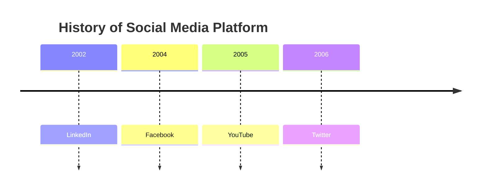
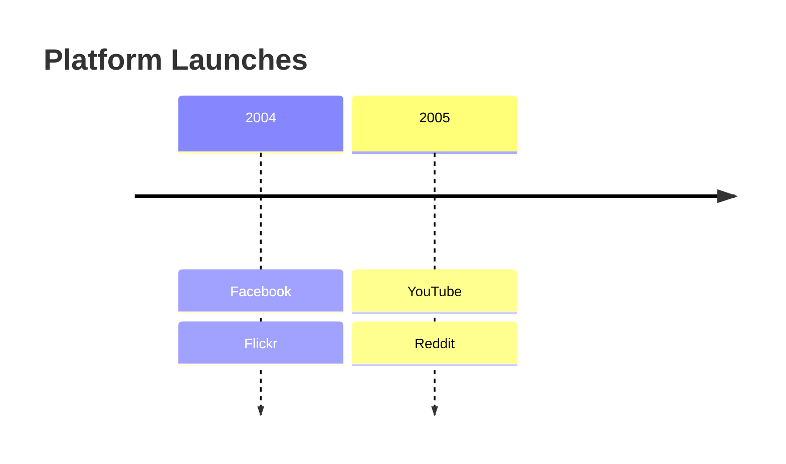
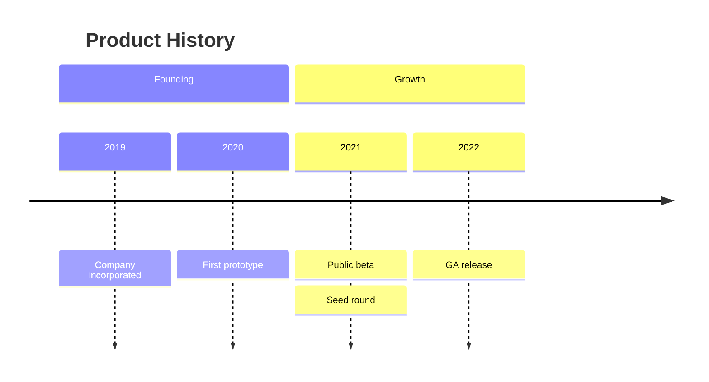
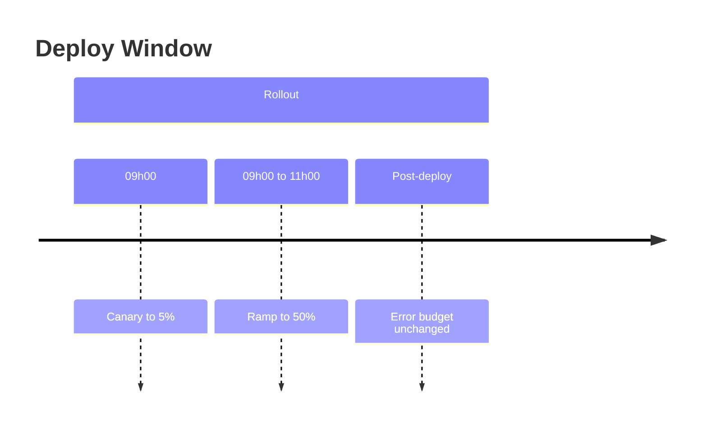
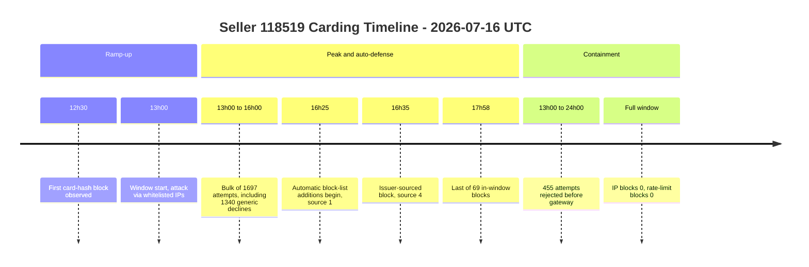
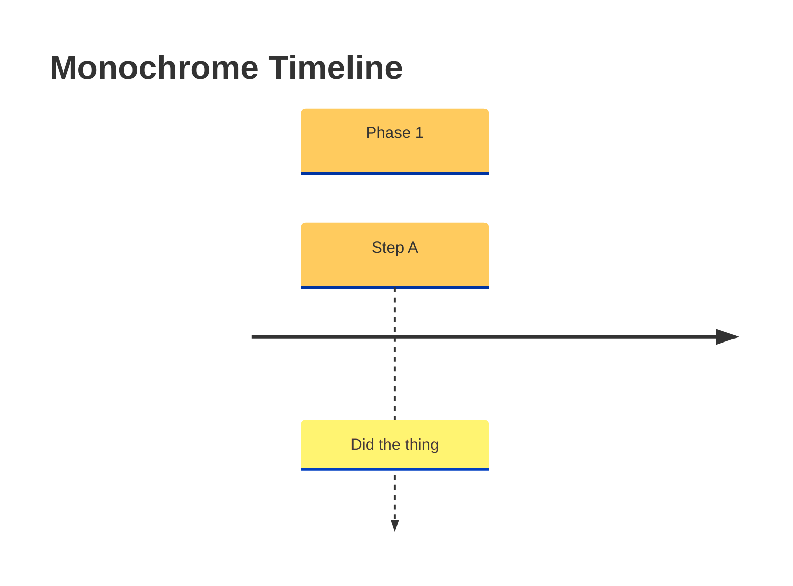
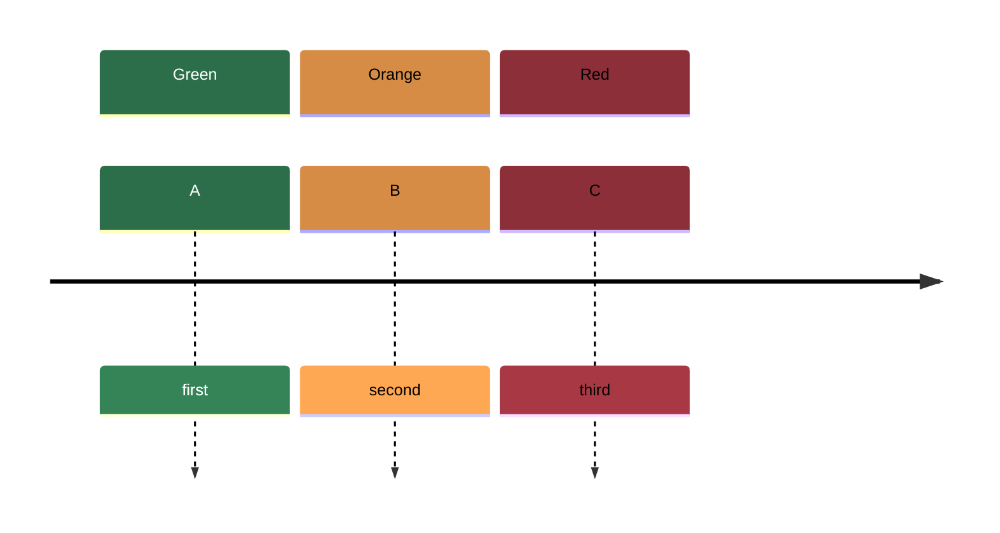

# Timeline Diagrams

Timeline diagrams present a chronological list of events grouped into optional
sections. They are the right choice when the *order* and *grouping* of events
matters but exact durations do not — incident reports, attack narratives,
product history, release chronologies, onboarding sequences.

Use a **Gantt chart** instead when you need real durations, dependencies, or
calendar-accurate bars. Use a **sequence diagram** when the story is about
messages between participants rather than points in time.

## Basic Syntax

**Structure:**
- First line is `timeline`
- Optional `title <text>`
- Each event line is `<time period> : <event>`
- Everything before the first `:` is the time period; it is free text
- Everything after is the event text

## Multiple Events per Period

Chain additional events with more colons, or put each on its own indented line:

Both forms render as several event boxes stacked under the same period.

## Sections

Sections group consecutive periods under a heading and give each group its own
color:

Every period after a `section` line belongs to that section until the next
`section` line.

## Free-Text Periods

The period column is not parsed as a date, so any label works — clock times,
ranges, phase names, version numbers:

## Worked Example: Incident / Attack Timeline

A carding-attack narrative, where the interesting structure is phase grouping
plus a few hard timestamps and some window-wide aggregates:

**Why this works:**
- Sections carry the analytical story (ramp-up → peak → containment), not just time
- Exact timestamps are used where a discrete thing happened; ranges where a
  volume accumulated
- Counts live in the event text, so the diagram doubles as the summary table
- A final `Full window` period holds window-wide facts, including the negative
  findings (zero IP blocks, zero rate-limit blocks) that rule causes out

## Styling

Timelines accept the standard themes plus a `disableMulticolor` option that
turns off per-section coloring:

Custom section colors come from `themeVariables` `cScale0`, `cScale1`, … (one
per section, in order):

## Pitfalls

- **Colons in event text** split the line into more events — write `12h30 UTC`
  rather than `12:30 UTC`, or the time becomes two boxes
- **No date math** — periods are strings, so entries render in the order you
  write them; the diagram will not sort or space them chronologically
- **Long event text** widens boxes and squeezes neighbors; keep events to a
  short clause and push detail into surrounding prose
- **Sections are sequential** — you cannot reopen an earlier section later in
  the diagram; reorder the events instead
- **Renderer support** — timeline needs Mermaid v9.4+; older embeds fall back to
  a syntax error
